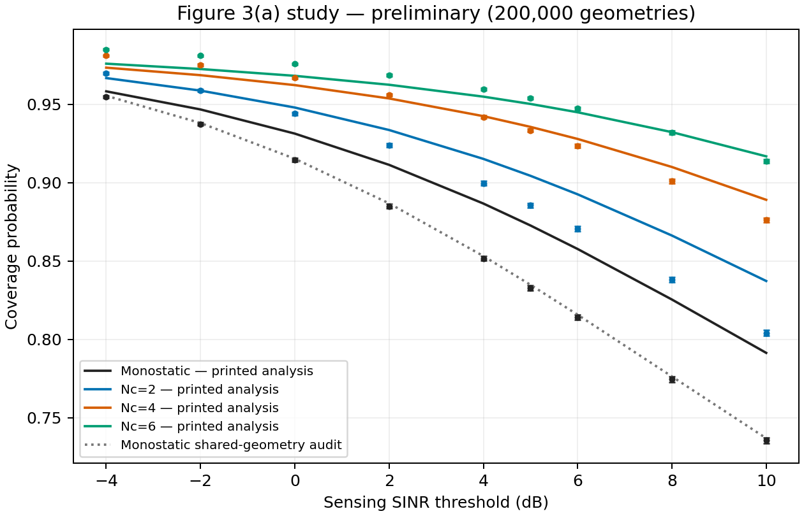
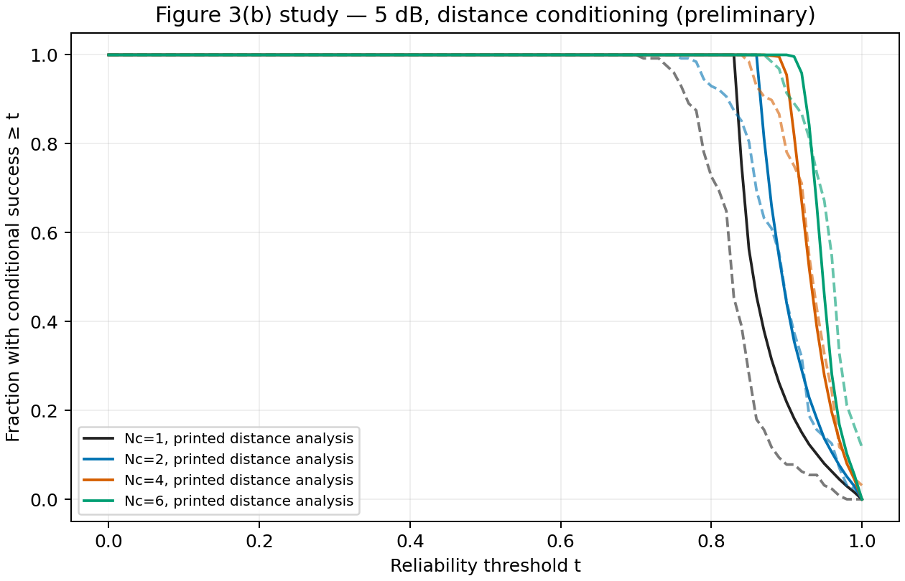
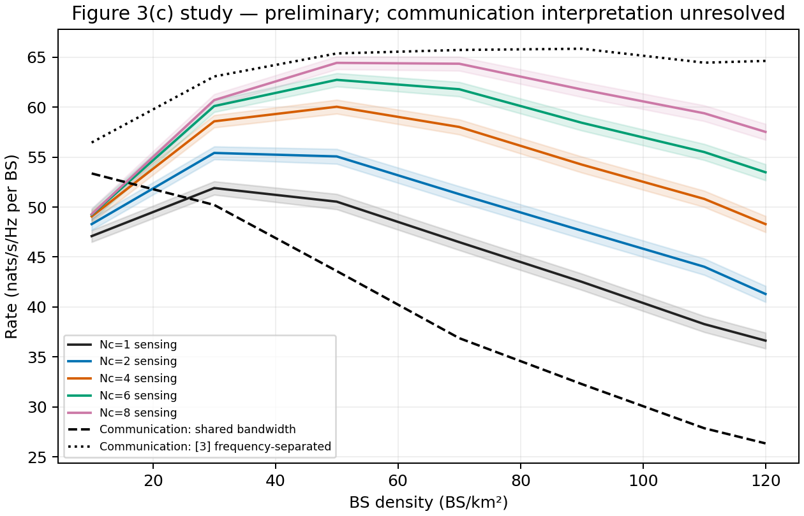
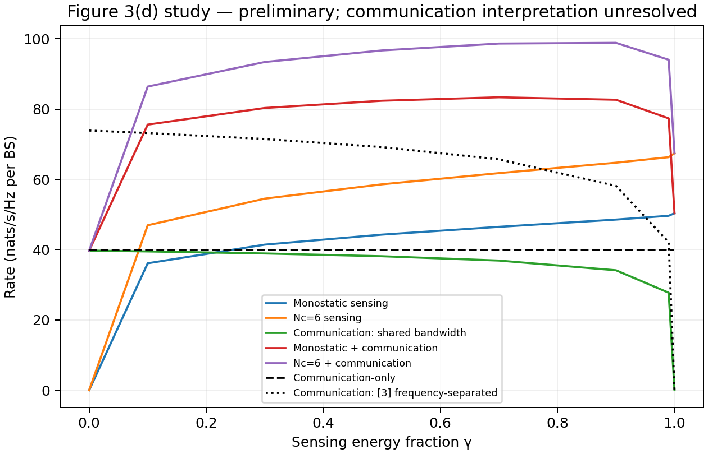
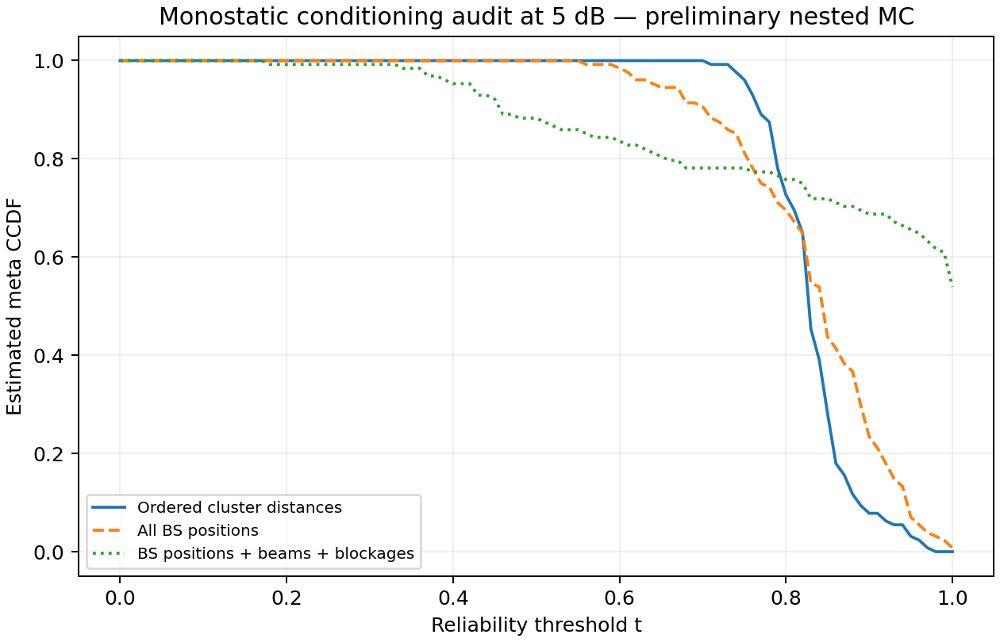

# Reproduction evidence and unresolved issues

**Status: preliminary reproduction study; numerical components validated on the checks below. Original Figure 3 is not claimed reproduced.**

The complete primary paper was read before implementing its model. Reference [3] was located and its necessary communication derivations read. No original numerical data or digitized curves are available. The source PDFs were visually inspected, including equations and Figure 3.

## Figure 3(a): sensing coverage

The final run used **200000 independent PPP network realizations in 25 km²**, the stated paper density of 70 BS/km², the §IV values, fixed seed 20261010, original exponential echo powers, and the disclosed top-hat/equally-spaced/per-beam choices. Analytical spatial integration used 256 scrambled Sobol distance vectors.

| Cluster | Monte Carlo at 5 dB | 95% Wilson interval | Printed analysis | Analysis − MC |
|---|---:|---:|---:|---:|
| 1 | 0.833010 | [0.831369, 0.834638] | 0.872691 | +0.039681 |
| 2 | 0.885535 | [0.884132, 0.886923] | 0.904413 | +0.018878 |
| 4 | 0.933460 | [0.932359, 0.934544] | 0.935651 | +0.002191 |
| 6 | 0.953985 | [0.953058, 0.954895] | 0.950288 | -0.003697 |

The monostatic gap is about **0.0397 absolute probability**, far above the numerical integration and series errors. Monostatic useful power is exactly exponential, so Gamma fitting and Alzer cannot explain this baseline gap. The independent shared-geometry joint-PGFL audit gives 0.834861 using 1024 distance samples, versus the printed 0.872691. This supports investigating the printed exclusion/independence approximations. It does not identify the authors’ actual figure-generation code.

The joint-PGFL audit is close to the 200000-sample Monte Carlo result but **just outside its pointwise 95% interval** (about 2.2 standard errors). An independent 20000-sample check at 5 dB includes it; the 10 dB check marginally misses its pointwise interval. These misses are retained in the raw output, rather than described as universal 95% agreement. Finite-window error, beam-layout ambiguity, numerical spatial integration error, and ordinary sampling variation have separate roles. Further independent high-count checks would be appropriate before claiming sub-0.001 accuracy.

The plotted simulation trends visually resemble Figure 3(a): falling coverage, cooperation gains, and diminishing increments. The literal printed analytic curves do not match our simulator for all clusters. No pointwise original-paper numerical errors are reported because visual estimation is not numerical ground truth.

## Figure 3(b): which reliability is being distributed?

This run uses 512 analytical distance vectors per cluster and 128 independently sampled distance vectors × 128 inner Monte Carlo resamples. Conditional-distance inner trials resample cluster azimuths, outside PPP points, beam rotations, blockages, fading, and RCS. The full-marked-geometry comparison holds points/beams/blockages fixed and resamples fading/RCS. Both are saved and labeled distinctly.

| Cluster | Distance-MC mean success | Outer-group 95% mean interval | Printed distance-analysis M1 | Estimated distance fraction ≥0.9 | Estimated marked-geometry fraction ≥0.9 |
|---|---:|---:|---:|---:|---:|
| 1 | 0.830017 | [0.821324, 0.838710] | 0.872693 | 0.0781 | 0.6875 |
| 2 | 0.890381 | [0.881159, 0.899602] | 0.904424 | 0.4453 | 0.7734 |
| 4 | 0.931519 | [0.924932, 0.938105] | 0.935590 | 0.7812 | 0.8359 |
| 6 | 0.956604 | [0.951147, 0.962061] | 0.950288 | 0.9141 | 0.8906 |

All distance-MC first-moment intervals contain the independently seeded unconditioned 200000-network mean for the same cluster/model. Averaging each nested group and pooling the same nested trials agree exactly, as required by total expectation. That algebraic equality alone is not independent validation. The printed analysis has different first moments because its model is approximated.

At 5 dB and reliability 0.9, the monostatic estimated fraction is 0.078 under distance conditioning but 0.688 under full marked-geometry conditioning. This shows why conditioning is central. These finite-inner-MC tail values are **preliminary**: the worst-case single-probability 95% half-width with 128 trials is approximately 0.087. The supplementary Wilson intervals in `meta_uncertainty.json` describe the distribution of noisy conditional estimates, not a confidence band for the exact PS meta-distribution.

The distance-conditioned curves differ substantially from the published Figure 3(b), whose visible shape resembles a much more dispersed reliability population. The marked-geometry diagnostic is more dispersed. This is a conditioning discrepancy to resolve with the authors, not proof that a specific alternative conditioning generated their figure. In the stated noisy continuous-echo model, exact conditional success is less than one for finite distances; empirical all-success inner trials must not be interpreted as exact reliability-one atoms. The published plotting grid near t=1 is unknown.

Gil–Pelaez inversion is implemented independently of the empirical conditional-probability CCDF. A Uniform(0,1) test gives errors below 10⁻⁵ at t=0.2,0.5,0.8. On the actual discrete spatial sample, doubling the frequency cutoff from 200 to 400 leaves ringing of up to about 0.014; some raw values exceed 1 by about 0.011. Nothing is clipped. The main plot uses the empirical CCDF of the same conditional probabilities; the raw inversion and comparison plot are supplied as diagnostics.

## Figures 3(c),(d): rate trends and communication transfer

Both sweeps use 6000 geometries per setting; rates are preliminary Monte Carlo means with saved 95% Student mean intervals. Sensing is Nb E[log(1+SINR)] in nats/s/Hz per BS. Communication includes Nb(Tt−Ts)/Tt. Cluster sizes 1,2,4,6,8 are included for the density sweep; the energy-split figure highlights 1 and 6. Full endpoints γ=0 and γ=1 are evaluated rather than replaced with hidden epsilons.

At the default setting the 200000-network sensing rates are:

| Cluster | Rate | 95% mean interval |
|---|---:|---:|
| 1 | 46.3766 | [46.2383, 46.5149] |
| 2 | 51.4403 | [51.3041, 51.5766] |
| 4 | 57.6594 | [57.5288, 57.7899] |
| 6 | 61.4325 | [61.3073, 61.5578] |

With the primary paper’s shared-band statement, communication at the default setting is about 37.1 nats/s/Hz in an independent 20000-user check. Literal reuse of [3]’s one-cochannel-beam interference model gives about 65.6. The distinct curves are shown; importing [3] without adapting its frequency architecture would materially change the result. The shared-band version follows the physical statement in §II, but its identity to the authors’ implementation is unresolved.

The density sweep shows a sampled sensing optimum near 30 BS/km² for monostatic sensing and near 50 BS/km² for Nc=6, while communication decreases over most sampled densities. These coarse-grid optima are not precise continuous optimizers. The energy-split sum peaks around γ=0.7–0.9 on the sampled grid, then drops as communication power vanishes. The communication-only curve uses 1 W continuous data power and no sensing-pulse duty penalty. Summed sensing-information and communication rates are the paper’s comparison metric, not an operational proof of additive throughput.

The written analytical rate integrations are also exercised. Tightening the rate grid from t≤30 with Δt=0.5 to t≤40 with Δt=0.25 changes the printed Nc=1/Nc=6 rates by about 0.026/0.019 nats/s/Hz on the same 32-point spatial sample. Terminal sampled coverage numerically underflows to zero. This is convergence of those sampled integrals, not a rigorous bound on unsampled near-zero-distance tails. Analytical rate spatial quadrature here is deliberately small and not claimed fully converged.

## Numerical and simulation checks

| Check | Evidence and limit |
|---|---|
| Fresh installation | Python 3.12 venv, pinned dependencies, integration/rendering check, 1000-network baseline all executed successfully |
| Original echo moments, Eq. (5) | 200000 powers at one specified distance vector: mean relative error 0.00152; variance relative error 0.00576 |
| Gamma fitting / Alzer | At that vector, maximum sampled survival errors ≈0.00207 (Gamma vs original), ≈0.00102 (Alzer vs Gamma). These are configuration-specific, not global error bounds |
| Reflected radial transform | Complex E1 reduction agrees with independent infinite-range quadrature across a=10⁻⁴,…,10⁸ |
| Direct LT, Eq. (11) | Log-grid values agree with independent quadrature to about 1.1×10⁻⁵ at the tested arguments; surrogate Monte Carlo also checked. The surrogate excludes the nearest point by construction |
| Reflected nearest-point audit | At R1=80 m and s=10⁹ W⁻¹, literal Eq. (13) gives 0.877855; exact outside-R1 PPP gives 0.834397. This is a model difference, not a quadrature difference |
| Independent reflected follow-up | A 50000-draw test marginally missed a pointwise 95% interval at its strongest argument. A separate 200000-draw seed brings all three exact values within their reported intervals; both runs are retained |
| Noninteger series | k=1,1.15,1.4,2,2.5,4 tested against the stable unexpanded Alzer expression. Tested 1024-term errors below 10⁻⁶ |
| Actual-series refinement | Tightening the tolerance from 2×10⁻⁴ to 2×10⁻⁵ changed tested conditional probabilities by at most 0.000175; no shape rounding or clipping |
| Radial/guard quadrature refinement | Doubling resolutions changed tested sensing conditional probabilities by at most ≈2.2×10⁻⁶ |
| Joint monostatic audit | Independent derivation; doubling angular/radial nodes changes conditional probabilities by <5×10⁻⁷; rate ≈46.41 vs independent simulated ≈46.30 |
| PPP nearest distances | 100000 ordered-distance vectors: exponential squared-area gaps have empirical means within 0.008 of one |
| Limits | Zero sensing power gives zero sensing SINR; zero communication power gives unit direct-interference LT |
| First moments | Nested identity exactly zero error; independently seeded nested/unconditional means statistically compatible; printed model kept distinct |
| Communication | Cosine gain integration and [3] finite Alzer sum exercised separately; shared-band coverage error up to ≈0.0106 at the tested thresholds, consistent with an approximation requiring quantification |

Area sensitivity used 10000 networks per independent 6.25,25,100 km² run. At 5 dB monostatic estimates were 0.8343,0.8347,0.8412 with overlapping intervals. No drift was statistically resolved at this precision; this does **not** establish zero boundary bias or accuracy of 10⁻⁴. Quarter/full sample comparisons show shrinking intervals. Spatial integration at 64,256,1024 points changes printed 5 dB average coverage by less than roughly 0.0004 in the tested mono/Nc=6 cases, much smaller than the baseline model discrepancy.

## Equations to code

| Paper item | Code |
|---|---|
| §II waveform / §IV defaults | `config.py`: `Config` and derived powers/timing |
| (1),(2),(3),(4),(7)–(10) | `simulation.py`: `beam_offset`, `spatial_marks`, `sensing_slot` |
| (5),(6) | `analysis.py`: `echo_moments` |
| (11) | `analysis.py`: `DirectLT`, `direct_lt_quad` |
| (12),(13) | `analysis.py`: `reflected_lt`, `reflected_integral` |
| (14) | `analysis.py`: `conditional_coverage`; real-shape recurrence and explicit error bound |
| (15),(16) | `ordered_radii`, `distance_qmc`, averages in `cli.py` |
| (17) | `analysis.sensing_rate`; direct log1p estimator in `cli.py` |
| (18)–(20) | `statistics.py`: `meta_ccdf`, `moments`, `gil_pelaez`; nested conditioning in `simulation.py` |
| (21),(22), [3] (24)–(27) | `communication.py`; `communication_simulation`; both beam-frequency interpretations |
| Extra independent audit | `monostatic_audit.py`; derivation in `monostatic_derivation.md` |
| Validation / convergence | `validation.py`, `inspection.py`, `cli.py` |

## Positions alone versus full marked geometry

The additional `positions_meta` command fixes every BS position but resamples beam, blockage, fading, and RCS marks. This is conditioning on the complete unmarked PPP, not just ordered cluster distances. For the monostatic 5 dB case, estimated mean success is 0.83234 (outer-group 95% interval 0.81591–0.84876). The estimated fraction meeting reliability 0.9 is 0.2344, compared with 0.0781 under distance conditioning and 0.6875 under fixed beam/blockage marks. All three have the same unconditional mean in the ideal limit, but distribute different conditional probabilities. With only 128 inner samples these tail estimates remain preliminary.

## What is needed for an exact reproduction claim

Clarify the power-budget scope, sensing-simulator antenna pattern, beam layout, cross-beam SI treatment, intended exclusion/conditioning implementation, and communication frequency-transfer convention. Obtain the original Figure 3 numerical curves or code. Resolve the Figure 3(b) conditioning discrepancy and increase nested-MC precision before presenting high-reliability-tail agreement. These are scientific model/data questions; the development environment and runnable study are available. No equations have been silently repaired or parameters tuned to obtain apparent agreement.
